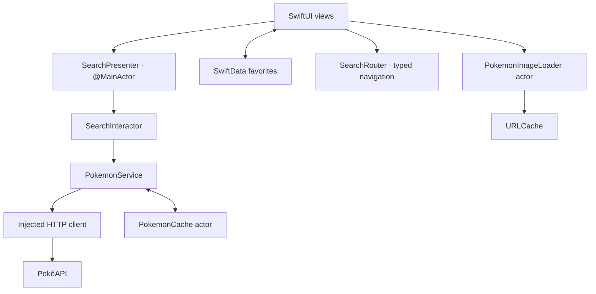

# Pokédex · SwiftUI + VIPER

[](https://github.com/izabelareisv/Pokedex/actions/workflows/ci.yml)

Explore Pokémon, save favorites, compare base stats and discover evolution families in a native iOS app built with **Swift 6, SwiftUI, Observation and SwiftData**, powered by [PokéAPI](https://pokeapi.co/).

The implementation combines VIPER responsibilities with native SwiftUI state and navigation. Its engineering focus is predictable presentation state, controlled concurrency and reliable data access, with cancellation, partial failures and offline recovery handled throughout the main user flows.

[Engineering highlights](#engineering-highlights) · [Features](#features) · [Run locally](#run-locally) · [Architecture](#architecture) · [Tests](#tests)

<p align="center">
  
</p>

*Pikachu animation used during search and pagination.*

## Engineering highlights

| Focus | Development decisions |
| --- | --- |
| Architecture | Defined View, Presenter, Interactor, Entity and Router responsibilities, with injected dependencies and [typed navigation](PokedexViper/Screens/PokedexSearch/Router/SearchRouter.swift). SwiftUI remains responsible for rendering and observation. |
| Swift concurrency | `async/await`, bounded task groups, `Sendable` models and actor-isolated caches. The [presenter](PokedexViper/Screens/PokedexSearch/Presenter/SearchPresenter.swift) updates UI state on `@MainActor` and guards against stale asynchronous results. |
| Resilient loading | Local-first search, explicit loading/empty/error states, typed HTTP failures and targeted retries. Successful results remain available when part of a request batch fails. |
| Persistence and caching | SwiftData favorites, an [atomic JSON cache](PokedexViper/Cache/PokemonCache.swift) with expiration and offline fallback, and a shared image loader that deduplicates in-flight downloads. |
| Regression testing | **59 Swift Testing declarations** covering data access, presentation transitions, concurrency, persistence and domain rules. Actor fakes, `URLProtocol` and injectable timing keep scenarios reproducible without live API requests. See [Tests](#tests) for the inventory and execution status. |
| Native presentation | Adaptive SwiftUI layouts, light/dark palettes, VoiceOver labels, Dynamic Type handling and a UIKit bridge for GIF playback that respects Reduce Motion. |

The comparison and evolution features also exercise domain modeling: stats are aligned by API identifiers, incomplete values remain explicit, and evolution trees preserve branching paths and alternative requirements. These rules are covered independently of the views.

## Features

| Feature | Behavior |
| --- | --- |
| Explore | Adaptive Pokémon grid, pages of 24, automatic pagination and a manual **Load more Pokémon** action. |
| Search | Immediate local matching, followed by a debounced API lookup when no loaded Pokémon matches. Search by name or number. |
| Filter and sort | Type and favorites filters; **Default**, HP, Attack, Defense, Special Attack, Special Defense and Speed ordering. Selected values appear in the filter buttons. |
| Favorites | Save Pokémon with SwiftData. Favorites mode resolves every saved ID directly, including Pokémon outside the loaded pages. |
| Compare | Select two Pokémon and compare base stats, types, height, weight and abilities side by side. Selection persists across searches and filter changes. |
| Evolution chains | Explore the full family, including branching paths and evolution conditions. The current Pokémon is highlighted; tap another member to open its details. |
| Details | Official artwork, abilities, English species descriptions, metric measurements and base stats, with a solid background based on the primary type. |
| Presentation | Red search and comparison screens, light/dark appearances, illustrated empty/error states, Pikachu loading animations and Reduce Motion handling. |

### Search, filters and pagination

1. Search checks the names and IDs of Pokémon already loaded in memory. Partial names work locally.
2. When there is no local match, the app waits for a **300 ms debounce**, then queries the API using a complete API name or numeric ID. Input is normalized for casing, surrounding whitespace and numeric leading zeros.
3. Loading remains visible until the lookup finishes. HTTP 404 becomes a no-results state; other failures offer a retry. Changing the query cancels the screen task, and stale responses cannot replace newer results.

API results join the loaded collection without duplicate IDs. Type filters and sorting apply to that collection. **Stat sorting ranks loaded Pokémon**; it does not request a global ranking of the entire Pokédex. New pages arrive in Pokédex order and are merged and sorted using the selected attribute.

In **Favorites** mode, the app first loads missing saved IDs, then applies the query, type and sort options to the favorite collection. This mode does not paginate or search for unrelated Pokémon, and the **Load more** button is hidden.

### Comparison

Tap **Compare** in the navigation bar, select two cards, then tap **Compare Pokémon**. Remove a selection using its selected card or the corresponding slot in the bottom bar. **Cancel** clears the selection.

The comparison uses existing Pokémon data and the shared image loader. Stats are matched by their API names, so response ordering does not affect the result. Both Pokémon share one bar scale, with an upper bound of at least 150 that expands to accommodate higher base stats. Higher values and numerical differences are highlighted; ties are labeled **Equal**, and missing values remain unavailable instead of becoming zero.

### Evolution families

The detail screen follows the species response's `evolution_chain` URL and preserves the family tree's branching relationships. Each member shows its parent and evolution conditions; alternative methods are displayed separately with **or**.

The current Pokémon keeps its selected form. Other members resolve through the species' default variety, avoiding assumptions that a species ID always equals a Pokémon ID. Default methods are preferred when the API identifies them. Available requirements include levels, items, friendship, time, trades and form-specific conditions; methods can vary by game and form.

Evolution loading and errors stay inside their section. A failure there leaves the Pokémon's other details available, with a dedicated retry action.

### Language and loading animations

The interface always uses **English**, independently of the device language. Names come from API identifiers with display formatting; species descriptions use the API's English entry. Measurements use kilograms and meters with English formatting.

The loading animations have deliberate timing:

- **Remote search:** the request begins after the debounce, and loading remains visible for at least three seconds from the lookup's start.
- **Pagination:** Pikachu runs for three seconds **before** the next-page request begins, then continues until loading finishes. The load button is hidden during the operation.

Waiting is asynchronous and cancellable. The presenter's sleep dependency is injectable, allowing regression tests to verify animation/request ordering without waiting three real seconds. The app retains its three-second default behavior.

## Run locally

Requirements:

- macOS with a full Xcode installation and a Swift 6 toolchain.
- An iPhone simulator or device running **iOS 17.2 or later**.

```sh
git clone https://github.com/izabelareisv/Pokedex.git
cd Pokedex
open PokedexViper.xcodeproj
```

Select the shared **PokedexViper** scheme and an available iPhone simulator, then run. No API key or third-party runtime dependencies are required.

The Swift package exposes **PokedexCore** for testing the non-UI code separately. It supports macOS 14+; it does not package the SwiftUI app, assets or SwiftData favorite model.

## Architecture

VIPER responsibilities are adapted to SwiftUI's observation and navigation model:



| Responsibility | Implementation |
| --- | --- |
| View | Renders list states and forwards user actions. Detail sections own their loading/error presentation. SwiftData queries stay in the UI layer. |
| Presenter | Owns the loaded collection, search revisions, filters, sorting, pagination, favorite hydration and loading state on the main actor. |
| Interactor | Maps API responses to domain values and assembles evolution families with bounded member lookups. |
| Entities and domain | Codable transport models; `Sendable` Pokémon values; comparison selection, stat matching and evolution condition formatting. |
| Router | Assembles the search module and owns typed routes for details and comparison. Evolution navigation reuses the detail route. |
| Service and infrastructure | Injected HTTP access, response validation, typed errors, JSON caching, image loading and connectivity observation. |

Protocols at the HTTP, cache, service and interactor boundaries allow tests to replace I/O. List/favorite detail batches allow up to **six concurrent requests**; evolution families allow up to **four concurrent member lookups**. Successful pages merge by ID, while partial failures retain successful results and retry only missing details.

These boundaries keep presentation decisions, data orchestration and persistence responsibilities explicit. Services and interactors can be exercised with controlled dependencies, while SwiftUI uses native observation and navigation. The comparison screen reuses existing Pokémon values and keeps its selection and stat-comparison rules in testable domain types.

### Cache and offline behavior

| Data | Storage and policy |
| --- | --- |
| Favorite IDs | SwiftData persistence across launches. Failed saves roll back and display a message. |
| Lists, details, species and evolution chains | An actor manages memory entries and atomic JSON files in the Caches directory, with a **24-hour TTL**. Expired data can be used when a request reports an offline error. |
| Images | A shared actor deduplicates in-flight requests by URL and uses `URLCache`, configured for **32 MiB memory / 128 MiB disk**. Image caching is separate from the JSON TTL. |

Connectivity monitoring can display an offline banner even when fresh cached data avoids a request. A successful online search clears the previous offline search status. HTTP/server failures remain distinct from offline fallback and from a confirmed no-result lookup.

Offline access depends on previously cached responses and images. A favorite stores its ID; cached artwork and metadata remain subject to system cache eviction.

## Project structure

```text
PokedexViper/
├── Domain/                     # Pokémon, comparisons, evolution families, favorites
├── Screens/
│   ├── PokedexSearch/
│   │   ├── Entity/             # API response models
│   │   ├── Interactor/
│   │   ├── Presenter/
│   │   ├── Router/
│   │   └── View/               # Search, detail and evolution UI
│   └── PokemonComparison/View/
├── Service/                    # HTTP, Pokémon service, connectivity and preview mocks
├── Cache/                      # JSON and image caching
├── Resources/                  # Design system, strings and shared views
├── Assets.xcassets/
└── PokedexViperApp.swift        # Startup and SwiftData container
PokedexViperTests/
Package.swift                   # Non-UI core and test targets
.github/workflows/ci.yml
```

## Tests

The test suite contains **59 declarations**: **58 core tests** and **1 hosted iOS persistence test**, including two parameterized declarations. The scenarios cover both user-facing behavior and the data/concurrency rules behind it. Execution evidence is recorded in [Validation status](#validation-status).

| Area | Declarations | Scenarios |
| --- | ---: | --- |
| HTTP, cache, interactor and images | 14 | Status/decoding errors, invalid URLs and query paths, HTTP 404 vs. server errors, cache expiration, offline fallback, measurements and image reuse. |
| Presenter lifecycle | 8 | Observable loading, bounded concurrency, cancellation, partial failures and recovery. |
| Search | 13 | Local priority, debounce transitions, normalization, numeric lookup reuse, stale/canceled responses, no-result caching and online recovery. |
| Favorites | 6 | Every saved ID, filters/sorting, no pagination, partial/total failures, retries and stale results. |
| Pagination | 5 | Delay before the request, duplicate actions, cancellation, favorite-mode transitions, retrying the same page and deduplication. |
| Comparison | 6 | Distinct selections, replacement/cancellation, stat alignment, ties, missing data and a shared scale. |
| Evolutions | 6 | Branches, alternative conditions, forms/default varieties, cached metadata, offline disk reuse, concurrency and cancellation. |
| SwiftData persistence | 1 | Reopening the store, recovering saved favorites and deletion. |

Tests use actor fakes, `URLProtocol`, isolated temporary cache directories and an injectable sleep function. They do not depend on live API requests.

Run commands from the repository root using a complete Swift/Xcode toolchain:

```sh
# Core suite
swift test

# Focused suites
swift test --filter FavoritesLoadingTests
swift test --filter PokemonComparisonTests
swift test --filter EvolutionTests
```

To include the SwiftData persistence test, run the shared scheme in Xcode or use an available iPhone simulator:

```sh
xcodebuild test \
  -project PokedexViper.xcodeproj \
  -scheme PokedexViper \
  -destination 'platform=iOS Simulator,name=iPhone 16' \
  -resultBundlePath build/TestResults.xcresult \
  CODE_SIGNING_ALLOWED=NO
```

Replace `iPhone 16` with a simulator installed on your machine. Standalone Command Line Tools installations can lack the Swift Testing runtime; the iOS app and hosted persistence test require full Xcode.

### Continuous integration

The [GitHub Actions workflow](.github/workflows/ci.yml) is configured for pushes and pull requests and performs:

1. SwiftLint with the repository's focused correctness rules.
2. The core suite through `swift test`.
3. The shared iOS scheme through `xcodebuild test`, selecting an available iPhone simulator and writing an `.xcresult` bundle.

The badge at the top links to the workflow's actual status.

## Validation status

| Check | Current evidence |
| --- | --- |
| Core and test compilation | Passed in local validation. |
| Standalone regression checks | Passed for comparison, evolution and 22 scenarios in the favorites, pagination, search and networking regression suites. |
| Full Swift Testing suite and hosted SwiftData execution | Require confirmation in a complete Xcode/runtime environment or CI. Local development validation used Command Line Tools without full Xcode. |
| iOS screenshots and walkthrough | Pending capture from a simulator or device. The animation above is a bundled asset. |
| Visual and accessibility audit | Light/dark layouts, VoiceOver, largest Dynamic Type sizes and Reduce Motion need simulator/device validation. Accessibility labels and adaptive layouts are implemented. |
| UI automation and coverage percentage | No UI test target or measured coverage report yet. |

## Data and implementation history

Pokémon data and artwork URLs are provided by [PokéAPI](https://pokeapi.co/). See its [API documentation](https://pokeapi.co/docs/v2) for species, evolution chains and Pokémon resources.

See [CHANGELOG.md](CHANGELOG.md) for the implementation history.
